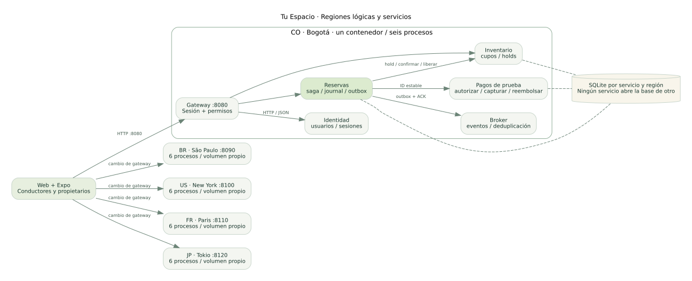
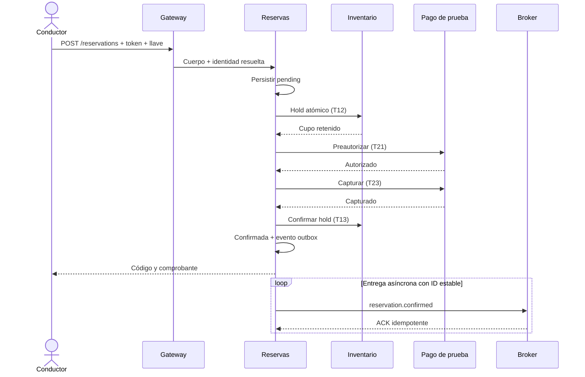

# Arquitectura de Tu Espacio

## Unidad de despliegue

Cada región lógica ejecuta seis procesos Python independientes. Cada proceso de servicio abre exclusivamente su propia base SQLite. El gateway no abre bases ajenas: resuelve sesión y enruta llamadas HTTP/JSON. El mismo código se parametriza con `server/regions.json`.

En el lanzador local, las cinco regiones usan grupos de seis puertos separados por diez posiciones. Con gateway 8080, identidad usa 8075, inventario 8076, pagos 8077, reservas 8078 y broker 8079. Los internos escuchan únicamente en `127.0.0.1`. En Compose cada contenedor regional usa esos mismos puertos internamente; solo el gateway sale al host como 8080/8090/8100/8110/8120.

Las cinco redes y volúmenes de Compose aíslan países lógicos. No representan centros de datos geográficos ni réplicas. El navegador cambia de región accediendo a su gateway; no hay una base global de reservas ni un coordinador global.

## Responsabilidades

| Proceso | Datos que posee | Decisiones |
|---|---|---|
| identity | Usuarios, hashes de contraseña y sesiones | Identidad y rol de la petición |
| inventory | Espacios, capacidad, ocupación sin reserva y retenciones | Un solo escritor serializa la asignación del último cupo |
| payments | Autorizaciones y estados del pago de prueba | Una autorización/captura por identificador de reserva |
| bookings | Reservas, llaves de idempotencia, journal y outbox | Coordina saga y compensaciones |
| broker | Mensajes recibidos, secuencia y destinatarios | Deduplica por ID de evento y expone notificaciones |
| gateway | Contadores efímeros de límite de login | Verifica sesión, acceso por rol y composición del panel |

## T0: reservar cupo con pago

1. Validar rol, duración, fecha, moneda/medio regional y cotización. Consultar idempotencia por usuario; una operación existente se recupera con su cuerpo original.
2. Persistir la reserva `pending` antes de llamar a otro servicio.
3. Inventario ejecuta `BEGIN IMMEDIATE`: expira holds vencidos, comprueba capacidad y registra el hold de diez minutos. La comprobación y escritura forman una transacción, sin ventana asíncrona entre ambas.
4. Pagos preautoriza y captura usando el ID de reserva como clave idempotente. El importe viene de la tarifa almacenada, no del cliente.
5. Inventario transforma la retención en compromiso confirmado. Reservas registra estado y evento en una misma transacción local.
6. Un trabajador de Reservas publica la outbox al broker. Solo marca entregado tras recibir confirmación. Si se pierde la respuesta del broker, el reenvío usa el mismo ID y no duplica el mensaje.

El cálculo de tarifa y comisión (T22 del diseño original) se guarda en el snapshot de la reserva antes de los efectos externos, no en un servicio contable separado. El total guarda impuesto incluido; base e impuesto suman exactamente el total.

## Fallas y recuperación

| Falla | Estado observable | Recuperación |
|---|---|---|
| Dos conductores piden el último cupo | Una reserva confirma; otra recibe `SPACE_TAKEN` | La exclusión mutua reside en Inventario, no en la pantalla |
| Pago rechazado | `compensating → failed` | Anular/reembolsar si corresponde y liberar hold |
| Respuesta de captura perdida | `pending` + pago quizá capturado | Consultar/repetir autorización y captura con el mismo ID |
| Hold vencido después de capturar | `compensating` | Reembolsar antes de terminar el aborto |
| Inventario cae durante cancelación | `cancelling` | Reembolso idempotente y posterior liberación |
| Inventario cae durante salida | `checking_out` | Liberar al recuperarse y persistir `completed` |
| Broker no responde | Evento en outbox sin entregar | El trabajador lo vuelve a publicar sin perderlo |
| Coordinador se reinicia | Journal y estados quedan en SQLite | El trabajador retoma operaciones recuperables |

El trabajador recorre operaciones recuperables una vez por segundo. Las trazas están acotadas a los últimos 128 pasos por operación para evitar crecimiento ilimitado durante una caída prolongada. No hay cola externa comercial ni garantía de entrega «exactamente una vez»: hay reenvío y deduplicación.

## Consistencia y coordinación

- Consistencia fuerte local para cupos mediante transacción SQLite, y para identidad/clave de reserva mediante restricciones únicas.
- No existe una transacción ACID global entre bases de servicios. La saga mantiene estados recuperables y ejecuta compensaciones.
- Exclusión mutua de la reserva en el coordinador mediante locks separados para llave de solicitud y reserva, adquiridos siempre en ese orden. El trabajador toma solo el lock de reserva. Inventario sigue siendo la autoridad final de capacidad.
- SQLite WAL permite lectores concurrentes y un escritor por base. Esta versión no soporta dos coordinadores contra una misma base: el escalado horizontal de escrituras requiere otro mecanismo de coordinación.
- Notificaciones y paneles tienen consistencia eventual. La web consulta cada 15 s cuando está visible y sin interacción activa; las mutaciones propias refrescan inmediatamente.
- Todos los instantes persistidos se expresan en UTC. La presentación utiliza `Intl` y zonas IANA, incluyendo cambios estacionales. El orden de la saga se obtiene de sus estados; el broker asigna una secuencia local. No se usa el reloj de un país como reloj global.

## Localización y dinero

Perfil = idioma, locale, moneda, decimales, zona, medios de pago, tarifas iniciales, impuesto didáctico y comisión de prueba. No hay ramas por país en la lógica de reserva. Las monedas se cobran en su región; no se agregan USD, COP y EUR como si fueran el mismo importe.

COP y JPY usan enteros sin decimales por la convención del ejercicio; BRL, USD y EUR usan centavos. El formateador rechaza importes fraccionarios y no finitos. Los nombres y mensajes se almacenan en UTF-8; los catálogos incluyen japonés.

Para agregar un sexto perfil se añade configuración, se levanta su gateway y se incluye en los puertos/redes de despliegue. El soporte de un idioma nuevo requiere además su catálogo; no se presenta una traducción inexistente como terminada.

## Seguridad y límites

El gateway valida la sesión con Identidad y transmite un contexto interno autenticado por clave de servicio. Un cliente no puede elegir su rol con `X-User`. Propietarios solo modifican sus espacios; el servidor fija propietario y métricas en las altas. Admin accede a supervisión de su región.

Las consultas usan parámetros SQL. El tamaño de JSON está limitado a 64 KiB; las respuestas aplican CSP, nosniff, referrer policy y no-store para datos. CORS usa una lista explícita, configurable con `CORS_ORIGINS`. Los tokens vencen en 12 horas; las contraseñas y tokens persistidos se guardan como hashes. Los datos de prueba son ficticios.

El HTTP interno es local al contenedor. Exponer el gateway fuera de una máquina de demostración requiere TLS en un proxy, secretos administrados, política de acceso y supervisión de operación. Estas precauciones de despliegue no están representadas como certificaciones de producción.

## Objetivos de un sistema distribuido

| Objetivo | Evidencia implementada | Límite |
|---|---|---|
| Transparencia de acceso | Contrato REST común para web/Expo | El perfil regional se muestra deliberadamente |
| Transparencia de concurrencia | Último cupo atómico e idempotencia | Una autoridad de inventario por región |
| Transparencia de fallas | Recuperación de saga y outbox | Una caída total exige restaurar procesos |
| Heterogeneidad y apertura | HTTP/JSON entre JS y Python | Integraciones externas siguen simuladas |
| Fiabilidad | Journal, WAL, compensación y deduplicación | No hay réplicas ni elección de líder |
| Escalabilidad | Partición por región y contratos por servicio | Un escritor SQLite por servicio |
| Rendimiento | Consultas regionales y actualización controlada | Sin benchmark de carga ni SLA medido |

## Fuentes y comprensión del diseño

Fuentes internas: contrato y código originales del repositorio, `Entrega_Hito4/informe.html`, PDF de la asignatura y confirmación del equipo sobre parqueaderos. Documentación técnica: [SQLite transactions](https://www.sqlite.org/lang_transaction.html), [SQLite WAL](https://www.sqlite.org/wal.html), [Python HTTP server](https://docs.python.org/3/library/http.server.html), [Python zoneinfo](https://docs.python.org/3/library/zoneinfo.html), [Expo SDK 58](https://docs.expo.dev/versions/v58.0.0/).

Se utilizó asistencia de IA para implementar y revisar este avance. El equipo debe ejecutar las pruebas y comprender la saga, sus límites y los contratos antes de sustentarlo.
